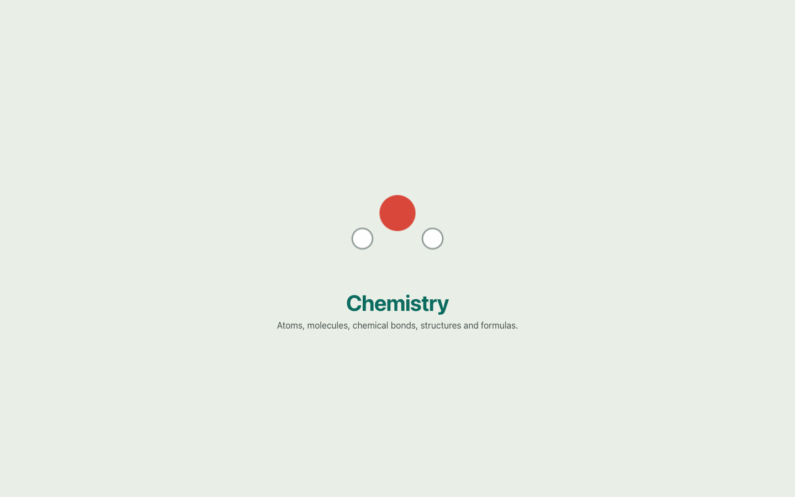
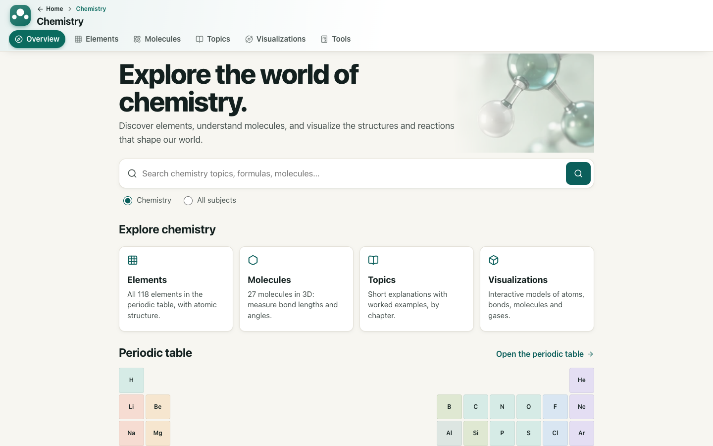
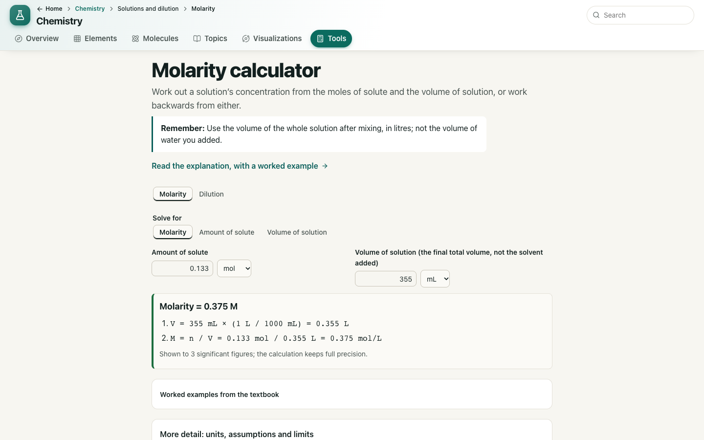
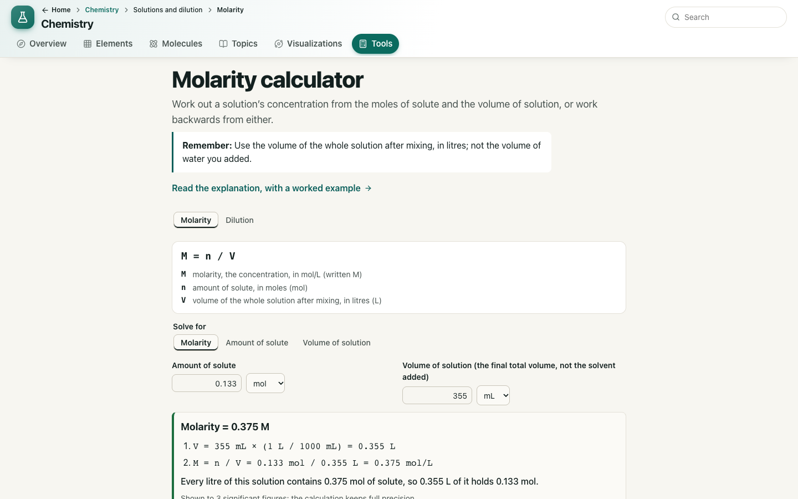
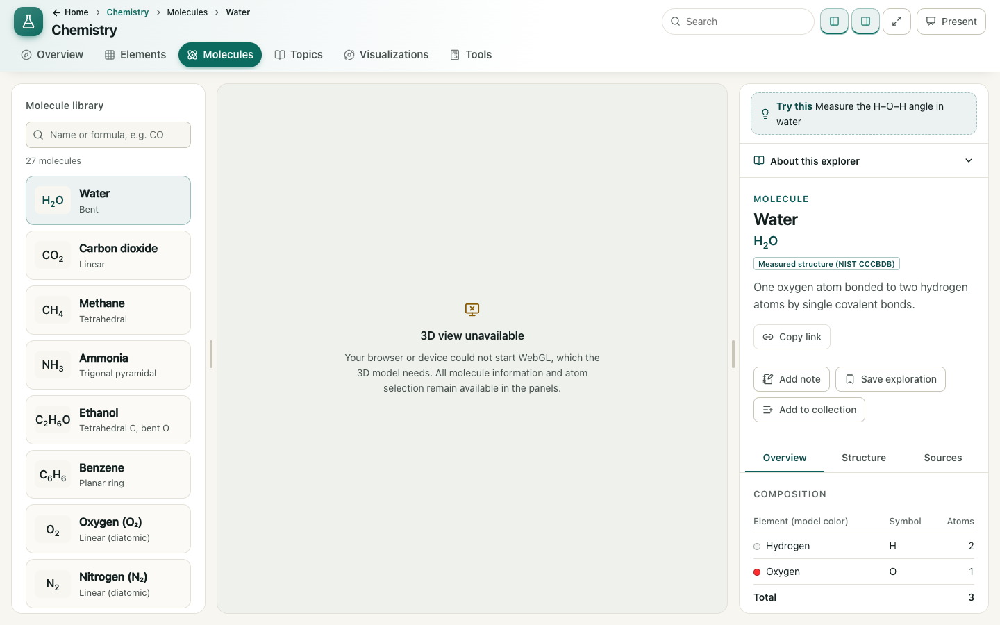
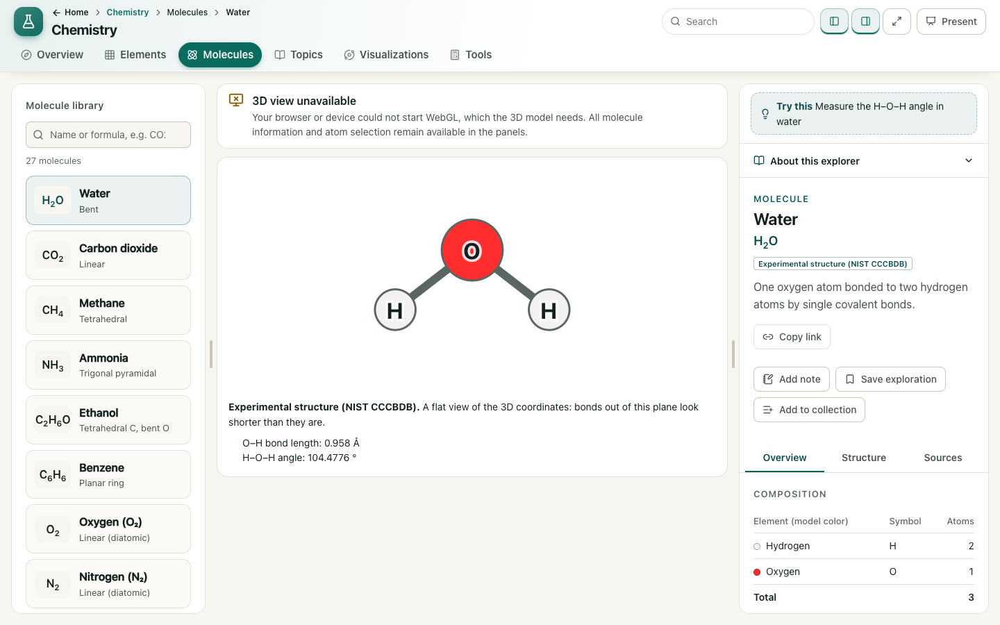
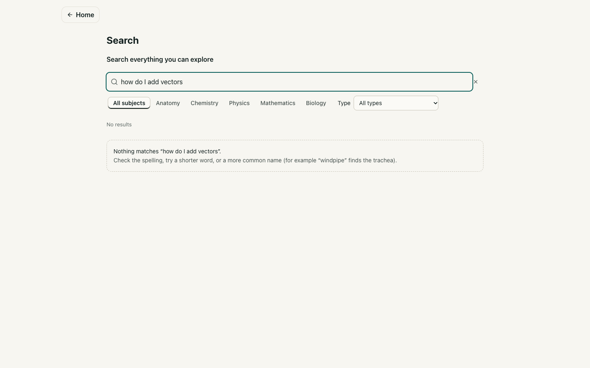
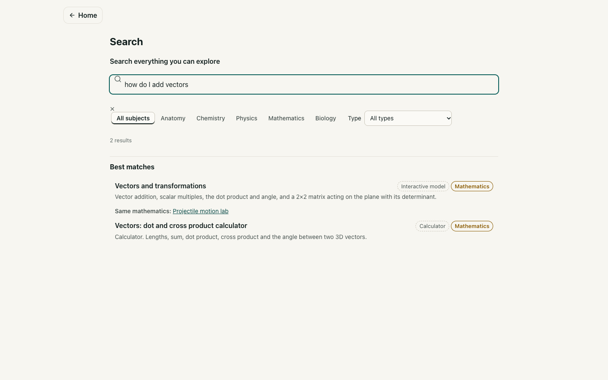

# QA report: trustworthy Chemistry

Branch `chemistry-trust`, 2026-11-04. The sources and corrections are in
[`docs/content-audit.md`](../content-audit.md). No student or subject expert has reviewed this work.

## What changed

1. **Subject intro:** a small animation in the header's subject mark replaces the full-screen curtain. It plays at most once per subject per browser session.
2. **Content:** the mole and geometry claims are corrected, and the five beginner topics were audited against sources that were read.
3. **Search:** every search understands student questions with fixed rules. Results say Explanation, Calculator or Interactive model.
4. **Journeys:** each next step opens the exact task, and calculators explain results and errors. When 3D fails, a compact message and a flat molecule drawing replace the empty panel.

## Bugs fixed

| Bug | How to reproduce on `main` | Now |
|---|---|---|
| Full-screen overlay that clicks pass through | Open a subject from Home | Animation stays inside the 42 px mark |
| Intro repeats | Home → Chemistry → Home → Chemistry | Once per session |
| False mole statement | `?csec=learn&lt=the-mole#/chemistry` | About 0.28 mol, with a worked example |
| All geometries called NIST measurements | Chemistry Overview footer | Experimental or computed, per molecule |
| Water model called "illustrative" | Water entry, More detail | Experimental, matching its data |
| Question found nothing | `?q=how do I add vectors#/search` | Vectors tool and calculator |
| "mole" matched "molecule"; short terms matched inside words | Search `mole`, `ion` | Whole words, or the start of a word |
| All-subject search ignored explanations | `?q=what is a mole#/search` | Explanations listed first |
| Home search forgot the query on Back | Search on Home, open a result, Back | Restored |
| "Also called: what is a mole" | Any beginner entry | Question aliases hidden |
| 3D code that fails to download could not be retried | Tab open across a deploy; *Try again* | Reloads once, then offers *Reload page* |
| Large empty panel without WebGL | Launch Chrome with `--disable-3d-apis` | Compact message and flat drawing |

Found and fixed during this QA, before release:

| Bug | Caught by |
|---|---|
| 355 mL compared with the 100 L limit in the new field check | Looking at a screenshot; the tests had passed |
| Result labels cut off on a 390 px phone; clear button outside the search box | Looking at a screenshot |
| Choosing the angle tool added `mtool` to the address | Full browser suite (`export.e2e.ts`) |

All three now have regression tests.

## Checks run

| Check | Result |
|---|---|
| TypeScript, lint | Pass |
| Unit tests | 1000 of 1000 |
| Production build | Pass |
| Full browser suite, all subjects, against the production build | 431 of 432 |
| After fixing that one failure: export, journeys, chemistry, activities, navigation | Pass (see note) |

**Note:** the full suite was not rerun after the last fix, which changed one address rule. CI on the pull request is the check for that.

A scripted sweep opened the homepage, five subject overviews, the journey pages, a tool in each other subject and search at 320, 390, 768 and 1440 px. None scrolled sideways at page level, and none logged a console error. Its flagged elements were KaTeX's hidden MathML, a table in its scroll area, and the periodic preview on the Overview.

Keyboard: Tab order on the mole page was checked, and each of the 14 stops has a visible focus ring. Copy link → fresh page restored the dilution calculator's state. Reduced motion, WebGL-unavailable behaviour and Search → result → Back are covered by browser tests.

## Remaining limitations

- **Duplicated navigation remains in other subjects:** the Anatomy, Biology, Physics and Mathematics *Module* switchers repeat their header tabs. They were kept because tests and behaviour depend on them, so this design check is **not met** for those subjects.
- **Screenshots reviewed by eye:** mainly the journeys and failure states at 390 and 1440 px. Most pages at 320 and 768 px had only the scripted checks.
- **Not tested:** Safari, Firefox, real phones, a screen reader, or a real GPU with a real WebGL failure (software rendering and `--disable-3d-apis` were used).
- **The original 3D error was not confirmed on the reporting computer.** It was reproduced by blocking the 3D code files. A true graphics failure there would still show the message, now with the flat drawing for molecules.
- **Sources:** see *Could not verify* in the content audit. Only water's coordinates were re-read.
- **No expert or student review.** Automated tests cannot establish scientific accuracy.

## Screenshots

Before: `docs/qa/before/`. After: `docs/qa/after/`, with the same file names.

| Page | Before | After |
|---|---|---|
| Opening a subject |  |  |
| Molarity calculator |  |  |
| Water without WebGL |  |  |
| Search: how do I add vectors |  |  |
